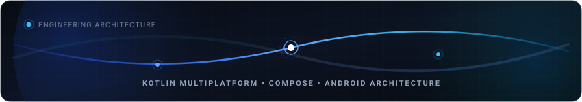
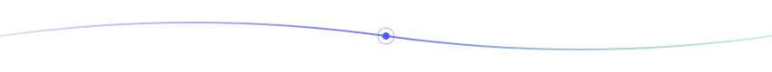

<!-- Ambient Vector Hero Graphic -->
<p align="center">
  
</p>

<!-- Native Responsive Typography & Status -->
<div align="center">

# Shahid Iqbal
### Senior Kotlin Multiplatform & Android Engineer

<p>
  <a href="https://shahid-iqbal.dev"></a>&nbsp;
  <a href="https://linkedin.com/in/shahidzbi"></a>&nbsp;
  <a href="https://x.com/shahidzbi"></a>&nbsp;
  <a href="https://medium.com/@shahid.iqbal4213"></a>&nbsp;
  <a href="mailto:shahid.iqbal4213@gmail.com"></a>
</p>

<p>
  <i>Crafting fluid cross-platform mobile architectures with Compose Multiplatform, AGSL GPU shaders, and native performance.</i>
</p>

</div>

---

### 💡 Executive Snapshot

```kotlin
val shahid = SeniorEngineer {
    role          = "Senior Kotlin Multiplatform & Android Engineer"
    location      = "Pakistan 🇵🇰"
    coreFocus     = listOf(Kotlin2x, ComposeMultiplatform, JetpackCompose, AndroidNative)
    specialties   = listOf(AGSLShaders, SensorFusion, OfflineFirst, AudioVideoPipelines)
    architecture  = listOf(CleanArchitecture, MVI, ReactiveFlows, ModularKMP)
    passion       = "Building production-grade open source libraries & high-fidelity mobile UIs"
}
```

* 🧩 **Multiplatform Architecture:** Engineering shared business logic & UI across Android, iOS, Desktop, and Web using **Kotlin Multiplatform (KMP)** and **Compose Multiplatform (CMP)**.
* ✨ **Graphics & Shader Engineering:** Creator of **[mirage](https://github.com/Shahidzbi4213/mirage)** — 29 ultra-fast AGSL GPU shaders for Jetpack Compose, unlocking fluid procedural gradients and animated noise fields on Android.
* 🧭 **Hardware & Sensor Fusion:** Author of **[GeoQibla](https://github.com/Shahidzbi4213/GeoQibla)** — multiplatform sensor library combining accelerometer, magnetometer, and geolocation for sub-degree directional accuracy.
* ⚡ **Local-First & Tooling:** Architect of **[ReqLite](https://github.com/Shahidzbi4213/ReqLite)** (local-first REST API client for mobile) and high-performance video feed architectures with Media3/ExoPlayer.

---

### 📌 Featured Works & Repositories

| 🧭 **[GeoQibla](https://github.com/Shahidzbi4213/GeoQibla)** | ✨ **[Mirage](https://github.com/Shahidzbi4213/mirage)** |
| :--- | :--- |
| **KMP Sensor Fusion & Direction Library**<br/>Accurate directional calculation via device magnetometer, accelerometer & GPS with shared multiplatform math and native sensor hooks.<br/><br/>`KMP` `CMP` `Sensor Fusion` `Android & iOS`<br/>[](https://github.com/Shahidzbi4213/GeoQibla) | **AGSL Shaders for Jetpack Compose**<br/>29 ultra-fast, zero-dependency GPU shaders — procedural gradients, noise fields, and animated filters running entirely on the GPU.<br/><br/>`Jetpack Compose` `AGSL` `GPU Graphics`<br/>[](https://github.com/Shahidzbi4213/mirage) |

| 🖼️ **[WallpaperApp-Cmp](https://github.com/Shahidzbi4213/WallpaperApp-Cmp)** | ⚡ **[ReqLite](https://github.com/Shahidzbi4213/ReqLite)** |
| :--- | :--- |
| **Compose Multiplatform Wallpaper Client**<br/>Dark-first wallpaper client crafted with Compose Multiplatform running simultaneously on Android, iOS, Web (Wasm), macOS, Windows, and Linux.<br/><br/>`CMP` `Compose` `Wasm` `Multiplatform`<br/>[](https://github.com/Shahidzbi4213/WallpaperApp-Cmp) | **Local-First REST API Client**<br/>Lightweight mobile HTTP client for developers and QA engineers to compose, inspect, debug, and replay API requests directly on mobile.<br/><br/>`Kotlin` `KMP` `Ktor` `Mobile Tooling`<br/>[](https://github.com/Shahidzbi4213/ReqLite) |

| 🎬 **[SampleReelsApp](https://github.com/Shahidzbi4213/SampleReelsApp)** | 🍓 **[SquishOut](https://github.com/Shahidzbi4213/SquishOut)** |
| :--- | :--- |
| **High-Performance Video Feed Engine**<br/>Production-pattern vertical video feed architecture (Shorts/Reels) with intelligent segment preloading and caching using Compose & Media3/ExoPlayer.<br/><br/>`Compose` `Media3 / ExoPlayer` `Clean Arch`<br/>[](https://github.com/Shahidzbi4213/SampleReelsApp) | **Tactile Directional Puzzle Game**<br/>Fluid, physics-driven puzzle game exploring advanced gesture manipulation, haptic mechanics, and Compose animation primitives.<br/><br/>`Compose Multiplatform` `Game UI` `Physics`<br/>[](https://github.com/Shahidzbi4213/SquishOut) |

---

### 🛠️ Technical Competencies

| Domain | Focus & Technologies |
| :--- | :--- |
| **Multiplatform & Core** | Kotlin 2.x • Kotlin Multiplatform (KMP) • Compose Multiplatform (CMP) • Kotlin Native • Coroutines & Flow |
| **UI & Graphics** | Jetpack Compose • AGSL GPU Shaders • Canvas & Custom Drawing • Material 3 • Motion & Physics Gestures |
| **Architecture & Data** | Clean Architecture • Unidirectional Data Flow (MVI/MVVM) • Ktor Client • Room KMP • SQLDelight • Offline-First Sync |
| **Tooling & Platform** | Android Studio • Gradle KTS (Convention Plugins) • Perfetto Profiling • R8 / ProGuard • GitHub Actions CI/CD |

---

### 📊 GitHub Activity

<p align="center">
  
  
</p>

---

<p align="center">
  
</p>

<div align="center">

**Available for Senior Mobile Engineering roles, KMP architecture consulting, and open-source collaborations.**

<br/>

[Get in Touch](mailto:shahid.iqbal4213@gmail.com) • [View Portfolio](https://shahid-iqbal.dev) • [LinkedIn](https://linkedin.com/in/shahidzbi) • [X / Twitter](https://x.com/shahidzbi)

</div>
