<!-- Header Banner -->
<p align="center">
  
</p>

<!-- Social & Quick Links -->
<p align="center">
  <a href="https://shahid-iqbal.dev"></a>
  <a href="https://linkedin.com/in/shahidzbi"></a>
  <a href="https://x.com/shahidzbi"></a>
  <a href="https://medium.com/@shahid.iqbal4213"></a>
  <a href="mailto:shahid.iqbal4213@gmail.com"></a>
</p>

<p align="center">
  <a href="https://github.com/Shahidzbi4213?tab=followers"></a>
  <a href="https://github.com/Shahidzbi4213?tab=repositories"></a>
</p>

---

### 🚀 About Me

```kotlin
val shahid = SeniorEngineer {
    name                 = "Shahid Iqbal"
    role                 = "Sr. Kotlin Multiplatform & Android Engineer"
    location             = "Pakistan 🇵🇰"
    coreSpecialties      = listOf(Kotlin, ComposeMultiplatform, JetpackCompose, AndroidSDK)
    graphicsAndUI        = listOf(AGSLShaders, GPUAcceleration, Material3, FluidAnimations)
    architecturalMindset = listOf(CleanArchitecture, MVI, UDF, OfflineFirstPersistence)
    currentMission       = "Building production-grade KMP libraries & modern mobile experiences"
    status               = "Open to Android & Multiplatform collaborations"
}
```

- 🧩 **Multiplatform Engineering:** Specializing in **Kotlin Multiplatform (KMP)** & **Compose Multiplatform (CMP)** — engineering robust shared architectures across Android, iOS, Desktop, and Web.
- ✨ **Graphics & Shader Innovation:** Author of **[mirage](https://github.com/Shahidzbi4213/mirage)** — 29 ultra-fast AGSL GPU shaders for Jetpack Compose, pushing native Android graphics to new heights.
- 🧭 **Sensors & Native Hardware:** Author of **[GeoQibla](https://github.com/Shahidzbi4213/GeoQibla)** — multiplatform sensor fusion library for accurate directional calculation on Android & iOS.
- ⚡ **Local-First Tooling:** Building developer-first utilities including **[ReqLite](https://github.com/Shahidzbi4213/ReqLite)** (local-first REST client for mobile devices).
- 🌐 **Personal Hub:** Explore my articles and latest updates at **[shahid-iqbal.dev](https://shahid-iqbal.dev/)**.

---

### 📌 Featured Open Source Projects

| Project | Description | Platform & Tech | Stars |
| :------ | :---------- | :-------------- | :---: |
| 🧭 **[GeoQibla](https://github.com/Shahidzbi4213/GeoQibla)** | KMP library for real-time Qibla direction via sensor fusion (magnetometer + accelerometer) & geolocation | `KMP` `Android` `iOS` `Sensors` | [](https://github.com/Shahidzbi4213/GeoQibla) |
| ✨ **[Mirage](https://github.com/Shahidzbi4213/mirage)** | 29 ultra-fast, zero-dependency AGSL shaders for Jetpack Compose — GPU noise fields, procedural gradients & animated filters | `Compose` `AGSL` `GPU Shaders` | [](https://github.com/Shahidzbi4213/mirage) |
| 🖼️ **[WallpaperApp-Cmp](https://github.com/Shahidzbi4213/WallpaperApp-Cmp)** | Dark-first wallpaper client crafted with Compose Multiplatform running on Android, iOS, Web (Wasm), macOS, Windows, and Linux | `CMP` `Compose` `Wasm` `Desktop` | [](https://github.com/Shahidzbi4213/WallpaperApp-Cmp) |
| ⚡ **[ReqLite](https://github.com/Shahidzbi4213/ReqLite)** | Lightweight, local-first REST API client for Android and iOS to compose, inspect, debug, and replay HTTP requests on-device | `Kotlin` `KMP` `Ktor` `Mobile Tool` | [](https://github.com/Shahidzbi4213/ReqLite) |
| 🎬 **[SampleReelsApp](https://github.com/Shahidzbi4213/SampleReelsApp)** | Production-pattern vertical video feed engine (Reels / Shorts) with instant playback and caching using Compose & ExoPlayer | `Compose` `Media3 / ExoPlayer` `MVVM` | [](https://github.com/Shahidzbi4213/SampleReelsApp) |
| 🍓 **[SquishOut](https://github.com/Shahidzbi4213/SquishOut)** | Tactile, physics-driven unblocking puzzle game exploring advanced Compose animations and gestures | `Compose Multiplatform` `Game UI` | [](https://github.com/Shahidzbi4213/SquishOut) |

---

### 🛠️ Technical Arsenal

<details open>
<summary><b>Languages & Core</b></summary>
<br />

<p align="left">
  
  
  
  
  
</p>
</details>

<details open>
<summary><b>Mobile & Multiplatform</b></summary>
<br />

<p align="left">
  
  
  
  
  
</p>
</details>

<details open>
<summary><b>Architecture, Network & Data</b></summary>
<br />

<p align="left">
  
  
  
  
  
  
</p>
</details>

<details open>
<summary><b>Tooling, CI/CD & Performance</b></summary>
<br />

<p align="left">
  
  
  
  
  
  
</p>
</details>

---

### 📊 GitHub Activity & Analytics

<p align="center">
  
</p>

<p align="center">
  
  
</p>

---

<p align="center">
  
</p>

<p align="center">
  <i>"Write once, run native everywhere — with zero compromise on performance."</i><br /><br />
  <a href="mailto:shahid.iqbal4213@gmail.com"></a>
  <a href="https://shahid-iqbal.dev"></a>
</p>
